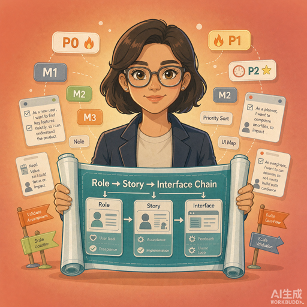
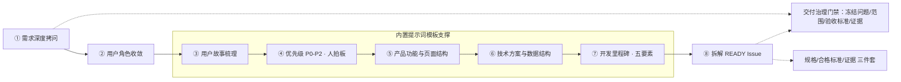

<div align="center">



# 需求翻译官 SpecBridge

**把业务语言，翻译成可开发、可验收的产品规格**

一个面向 vibe-coding 交付流程前半段的 WorkBuddy 专家包（Agent 型）

[](spec-bridge-expert/.codebuddy-plugin/plugin.json)
[](spec-bridge-expert/.codebuddy-plugin/plugin.json)
[](spec-bridge-expert/.codebuddy-plugin/plugin.json)

</div>

---

## 这是什么

你有一个模糊的想法，或一段说不清楚的业务诉求。SpecBridge 负责把它拷问清楚，一步步翻译成工程师能开发、验收方能验收的产品规格（Spec），最终产出交给下游开发的 **READY 状态 Issue**。

它的边界很克制：只做规划前半段，**不做开发实现、不做验收判定、不做发布上线**；所有方向性决策给 2-3 个方案权衡表，由人拍板，AI 不代决。

## 全能力链



> ③-⑦ 由内置的五份全流程提示词模板支撑（见 [`prompt-templates.md`](spec-bridge-expert/skills/spec-bridge/references/prompt-templates.md)）；①⑧ 由交付治理门禁兜底（见 [`delivery-gates.md`](spec-bridge-expert/skills/spec-bridge/references/delivery-gates.md)）——先冻结问题、范围、验收标准与证据方案，才允许产出；每个 Issue 三件套齐全才能置 READY。

## 核心能力

| # | 能力 | 产出 |
|---|---|---|
| 1 | 需求深度拷问 | 冻结问题、范围、非目标、验收标准 |
| 2 | 用户角色收敛 | 最小角色集（AI 提候选，人拍板） |
| 3 | 用户故事梳理 | 稳定编号的故事清单（US-001 式），主次分明 |
| 4 | 优先级排序 | P0/P1/P2 建议 + 理由 + 依赖说明，人拍板 |
| 5 | 功能与页面结构推导 | 功能清单、页面结构、关键使用路径，均可追溯到用户故事 |
| 6 | 数据模型与技术栈建议 | 字段级表结构 + 多方案权衡 |
| 7 | 开发里程碑拆解 | M1/M2 五要素（目标/范围/前置/交付/完成条件） |
| 8 | READY Issue 产出 | 规格 / 合格标准 / 证据方案 三件套齐全 |

## 工作方式（铁律）

- **AI 不代决**：方向性决策一律给出 A/B/C 方案 + 权衡表，等用户拍板；有歧义暂停提问，不自行假设
- **建议与事实分离**：AI 建议与已确认结论明确区分，用户确认后才写入事实文档；同一事实只在一个位置维护
- **开发与验收用同一份 Spec**：不为通过验收暗改标准、范围或历史记录
- **缺信息不编造**：缺失的数据、业务规则、约束列"待确认清单"向用户索取
- `main` 保持稳定：独立任务分支开发，验收通过后按授权合并，上线需明确确认

<details>
<summary>展开：完整工作流程（8 步）</summary>

1. **读现状**：读取项目 AGENTS.md 与 docs/ 确认已有事实；缺规范化结构时建议建立 `docs/facts/`（唯一事实）、`docs/Spec/`（任务规格）、`docs/工程规则.md`、`AGENTS.md`、`README.md`、`src/`（独立 Git 仓库，main 主分支）
2. **拷问需求，定角色**：确认产品核心目标，AI 提候选角色，用户收敛到最小角色集
3. **逐角色梳理用户故事**：每条含场景 / 关键操作 / 怎样算完成；稳定编号，信息不足的标记"待确认"
4. **定优先级**：P0=必须满足否则核心流程不成立；P1=明显改善体验但缺了仍能跑核心流程；P2=改善细节可推后；AI 给建议等级 + 理由，人拍板
5. **梳理功能与页面结构**：先 P0 后 P1/P2 推导功能清单，再推导页面安排，用"入口 → 页面 → 操作 → 后续页面或完成结果"描述关键路径，逐条确认 P0 故事能走通
6. **技术方案建议**：选型多方案权衡（含是否需要数据库）；需要数据库时给出字段级表结构与关联设计
7. **拆里程碑**：按五要素拆 M1/M2…，每个里程碑能单独演示和验证
8. **出 READY Issue**：规格 / 合格标准 / 证据三件套齐全并经用户确认后，交下游开发

</details>

## 目录导航

```
.
├── README.md                        ← 本文件
├── spec-bridge-expert/              ← 专家包源文件
│   ├── .codebuddy-plugin/plugin.json
│   ├── agents/spec-bridge.md        ← 角色定义 / 核心能力 / 工作流程 / 输出规范
│   ├── avatars/expert.png
│   └── skills/spec-bridge/
│       ├── SKILL.md                 ← 工具集说明
│       └── references/
│           ├── prompt-templates.md  ← 五份全流程提示词模板（核心资产）
│           └── delivery-gates.md    ← 交付治理门禁
└── packaging/spec-bridge.zip        ← 打包分享件
```

## 安装到 WorkBuddy

1. 将 `spec-bridge-expert` 目录内容放入专家目录：
   `~/.workbuddy/plugins/marketplaces/my-experts/plugins/spec-bridge/`
2. 运行注册脚本使其在专家中心可见：
   `python3 scripts/register_expert.py <expert-dir>`
3. 在专家中心打开「需求翻译官 SpecBridge」，试试这样问：
   - 帮我把这个想法翻译成可冻结、可验收的产品规格
   - 按用户故事梳理这个产品的功能优先级
   - 把这个产品拆成可独立验收的开发里程碑

## 说明

- 仓库不含密钥、真实用户数据与私有业务资料；头像为原创生成插画
- 作者：MarcJiang · 版本 1.0.1 · 运行环境：WorkBuddy（Windows）
